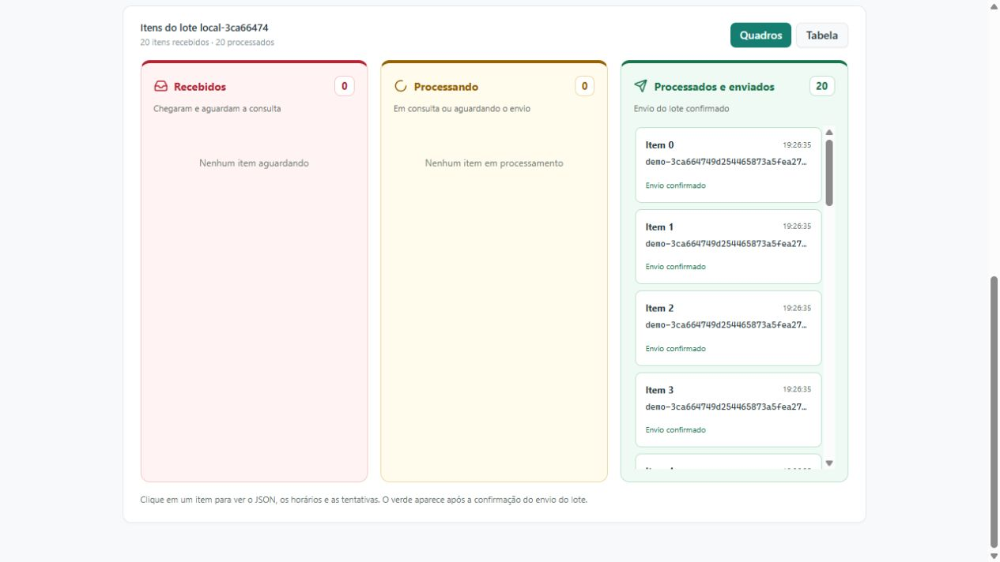
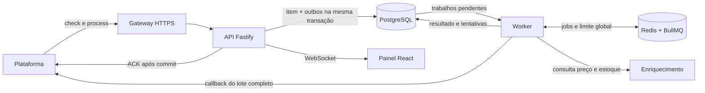

# Fluxo Relay

[](https://github.com/SirDarky/fluxo-relay/actions/workflows/ci.yml)

Serviço de integração que recebe lotes de SKUs, confirma o recebimento após
persistência, consulta preço e estoque em segundo plano e devolve o resultado
consolidado à plataforma. Um painel React acompanha cada execução pelo WebSocket.

**Stack:** Node.js 24, TypeScript, Fastify, PostgreSQL 18, Redis 7.4, BullMQ,
React e shadcn/ui. API e worker executam em processos separados no mesmo projeto.



## Executar

Requisito: Docker Desktop com containers Linux e Docker Compose.

```sh
git clone https://github.com/SirDarky/fluxo-relay.git
cd fluxo-relay
```

Copie a configuração na primeira execução:

```powershell
# Windows / PowerShell
Copy-Item .env.example .env
```

```sh
# Linux / macOS
cp .env.example .env
```

Depois, em qualquer sistema:

```sh
docker compose up -d --build --wait
```

Abra **http://localhost:4000** e clique em **Novo teste**. Escolha o fluxo feliz
ou o cenário com falhas temporárias. Cada simulação gera 20 itens e três
reentregas, passa pela API e pelo worker e termina com um callback local.
As migrations são aplicadas automaticamente; não há cadastro manual do banco.

A configuração de exemplo inicia com `PROCESSING_ENABLED=false`, permitindo
simular o fluxo sem chamar a plataforma externa. `DASHBOARD_TOKEN` vazio permite
acesso ao painel local; para habilitar os controles reais, configure uma chave.
Não sobrescreva um `.env` já configurado.

```sh
docker compose ps
docker compose logs -f api worker
docker compose down
```

`down` preserva os volumes. As portas publicadas são restritas ao computador local.
A API oferece `/health` e `/ready`; o gateway do webhook usa a porta 4100.

O início pelo Docker foi verificado em uma cópia limpa, com volumes novos,
incluindo uma simulação de 20 itens, três duplicatas e falhas recuperadas.

## Painel

- **Testes:** histórico com início, término, duração e resultado de cada lote.
- **Recebidos, em vermelho:** itens aguardando a primeira consulta; falhas
  definitivas aparecem identificadas neste quadro.
- **Processando, em amarelo:** consulta, espera entre tentativas ou resultado
  pronto aguardando a entrega do lote.
- **Processados e enviados, em verde:** o callback do lote foi confirmado.
- **Detalhes do item:** JSON recebido, horários, duração, duplicatas e tentativas.
- **Logs e Integração:** abas separadas para consultar eventos e operar o modo real.

A imagem acima é de uma simulação local. As execuções reais são identificadas
no painel. Os quadros são atualizados a cada segundo e recuperam o estado ao reconectar.

## Execução real

A integração completa foi validada em **06/10/2026**, com **100/100** na avaliação
da plataforma. O [relatório original da melhor execução](output/reports/execucao-real.json)
inclui a resposta recebida e os 20 resultados enviados.

| Indicador | Resultado |
| --- | --- |
| Itens corretos | 20 de 20 |
| Itens perdidos ou divergentes | 0 |
| ACK p95 / pior ACK | 546 ms / 562 ms |
| Limite de ACK | 600 ms, incluindo o túnel |
| Falha temporária HTTP 500 | Recuperada |
| HTTP 429 | 0 |
| Duplicata | Uma única consulta de enriquecimento |
| Callback | HTTP 200, resultado completo |

Essa nota corresponde à execução incluída; não representa um teste de carga de
20.000 itens. O tempo total mostrado pelo painel e o `duration_ms` do relatório
oficial têm escopos distintos e não devem ser comparados como a mesma medição.

## Integração externa

Configure no `.env` `PROCESSING_ENABLED=true` e uma `DASHBOARD_TOKEN` hexadecimal
aleatória, com 32 a 128 caracteres. Uma chave pode ser gerada com Node.js:

```sh
node -e "console.log(require('node:crypto').randomBytes(32).toString('hex'))"
docker compose up -d --build --wait api worker
```

Informe a chave no painel, na aba **Integração**. Exponha apenas o gateway
HTTPS na porta 4100, usando ngrok (`ngrok http 4100`) ou o túnel opcional:

```sh
docker compose --profile tunnel up -d tunnel
docker compose logs tunnel
```

Copie a URL HTTPS exibida, cadastre a integração pelo painel e solicite um lote.
O gateway publica somente `POST /check` e `POST /process`; o painel e o WebSocket
continuam locais. A URL temporária muda ao reiniciar o túnel e exige novo cadastro.
O `cid` e o token da plataforma são guardados no banco; o token não vai para o frontend.

Para parar o túnel: `docker compose stop tunnel`.
Cadastro, lotes, consulta do progresso e exportação também têm comandos CLI,
explicados em [Operação e desenvolvimento](docs/operacao.md).

## Arquitetura e decisões



**Quais decisões arquiteturais foram tomadas?** Separei a API do worker para
que o ACK não espere o enriquecimento. Fastify valida os contratos HTTP com
schemas, sem exigir uma estrutura maior de framework. PostgreSQL guarda o
estado durável e a chave `run_id + seq` impede processamento duplicado da mesma
posição. A API grava o item e uma outbox na mesma transação; o worker publica e
reconcilia os trabalhos no BullMQ, evitando perder o intervalo entre gravação e
publicação. Redis organiza a fila e impõe o limite global de três consultas em
voo, compartilhado entre workers. React e shadcn/ui apresentam esse estado pelo
WebSocket, com a lógica de integração concentrada no servidor.

**Quais trade-offs foram aceitos?** A persistência antes do ACK acrescenta uma
ida ao banco, mas permite responder sucesso somente quando o trabalho foi salvo.
A outbox é consultada a cada 250 ms, trocando alguma latência e consultas extras
por recuperação simples após interrupções. Há até oito tentativas, com espera
Fibonacci, jitter, teto configurável e respeito a `Retry-After`; erros permanentes
encerram o item e bloqueiam um callback incompleto. A leitura de enriquecimento
pode se repetir se o processo cair antes de salvar o resultado. Uma resposta
perdida do callback pode provocar outro envio, permitido pelo contrato; não há
garantia de um único envio sob falhas de comunicação. Retenção de eventos,
reprocessamento manual e operação contínua em produção ficam como evoluções.

**O que mudaria com 20.000 SKUs?** Manteria o limite de três consultas, porque
mais workers não aumentam a capacidade permitida pelo serviço externo. A 600 ms
por consulta, só o enriquecimento levaria cerca de 67 minutos, antes de retries.
Adicionaria publicação da outbox em lotes, índices e revisão das consultas de
reconciliação, retenção de eventos, métricas agregadas e monitoramento da idade
das pendências. O painel manteria paginação e receberia atualizações menores em
vez de snapshots completos. Para aumentar a concorrência ou dividir o callback,
seria preciso negociar o contrato; atualmente o resultado é enviado inteiro.

## Estrutura

```text
src/api/         HTTP, recebimento, integração e painel
src/worker/      filas, enriquecimento, retries e callback
src/shared/      contratos, configuração e conexões
src/webhook/     gateway público restrito
src/simulator/   plataforma local para demonstração
web/             React, shadcn/ui e acompanhamento ao vivo
migrations/      schema versionado do PostgreSQL
scripts/         operação e verificação
tests/          testes locais de integração e regras de retry
```

## Validação e desenvolvimento

Com Node.js 24 e os serviços Docker no ar:

```sh
npm ci
npm --prefix web ci
npm run typecheck
npm run typecheck:web
npm test
npm run build
npm run build:web
npm run verify
```

Os **49 testes** cobrem recebimento, duplicatas simultâneas, concorrência global,
falhas temporárias e permanentes, recuperação após interrupções, callback,
WebSocket, credenciais e estados dos quadros. Usam schemas temporários e uma
plataforma HTTP local, sem consumir lotes externos. A CI executa testes e
compilação com PostgreSQL e Redis próprios. `verify` verifica a stack local,
incluindo o worker separado; sua medição de ACK não inclui o túnel.

Para desenvolvimento com atualização automática, configuração das variáveis,
comandos CLI e detalhes de recuperação, consulte [Operação e desenvolvimento](docs/operacao.md).
